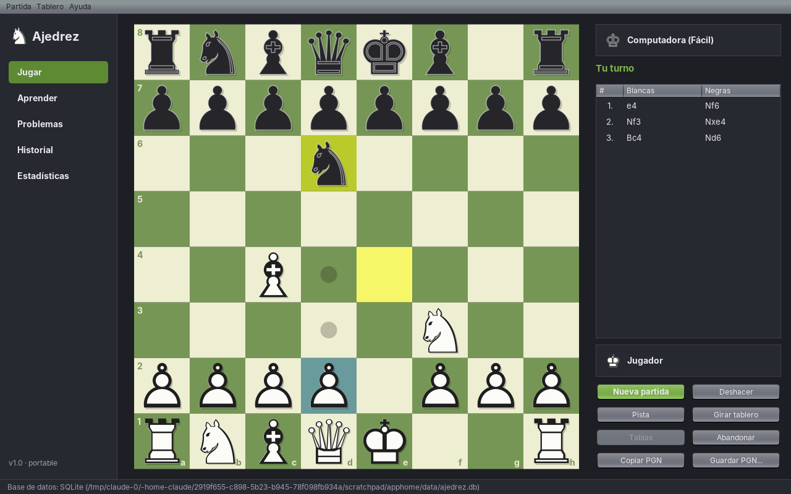

# Ajedrez

Aplicación de ajedrez de escritorio, **portable**, escrita en Java 21 + Swing, con motor propio de
5 niveles, apartado de aprendizaje (lecciones + problemas), historial de partidas y estadísticas.
Persistencia en **SQLite** (por defecto) o **PostgreSQL** (configurable).



## Funcionalidades

| Área | Qué incluye |
|---|---|
| **Jugar** | Contra la computadora o 2 jugadores en el mismo equipo · elegir color (o al azar) · deshacer · pista (flecha con la mejor jugada) · girar tablero · abandonar / tablas · copiar o guardar PGN |
| **Reglas** | Completas: enroques, al paso, coronación con elección de pieza, jaque mate, ahogado, material insuficiente, 50 movimientos y triple repetición. Validadas con *perft* |
| **IA (5 niveles)** | Principiante, Fácil, Intermedio, Difícil, Experto. Los niveles bajos cometen errores "humanos" (ruido + probabilidad de error), no solo piensan menos |
| **Aprender** | 23 lecciones en 5 categorías (fundamentos, movimientos especiales, principios de apertura, mates básicos, táctica), cada una con teoría + ejercicio interactivo |
| **Problemas** | Problemas tácticos ordenados por dificultad, pista en dos pasos (idea → jugada), registro de intentos y resueltos |
| **Historial** | Todas las partidas terminadas se guardan solas; reproductor jugada a jugada (botones o flechas del teclado), exportar PGN, eliminar |
| **Estadísticas** | Resultados y puntuación por nivel de dificultad, progreso de lecciones y problemas |
| **Interfaz** | Tema oscuro, 3 temas de tablero, coordenadas opcionales, mover con clic o arrastrando, resaltado de jugadas legales, última jugada y jaque |

## Cómo ejecutar

Requisitos para compilar: **JDK 21+** y **Maven**.

```bash
mvn clean package          # compila, corre los tests y genera target/dist/ajedrez.jar
java -jar target/dist/ajedrez.jar
# o en desarrollo:
mvn exec:java
```

En Windows también podés usar `scripts\ejecutar.bat`.

## Versión portable (sin Java instalado)

```bat
scripts\empaquetar-portable.bat     :: Windows  -> target\portable\Ajedrez\Ajedrez.exe (+ zip)
scripts/empaquetar-portable.sh      #  Linux/macOS
```

`jpackage` incluye un Java recortado dentro de la carpeta, así que se puede copiar a un pendrive y
ejecutar en cualquier PC. **Los datos viajan con la app**: la base y la configuración se guardan en
`data/` y `config/` junto al ejecutable (si esa carpeta no tiene permisos de escritura, se usa
`~/.ajedrez`). También se puede forzar la ubicación con `-Dajedrez.home=RUTA`.

## Base de datos: SQLite o PostgreSQL

Al primer arranque se crea `config/ajedrez.properties`:

```properties
db.type=sqlite                 # o postgresql
db.sqlite.file=data/ajedrez.db
db.postgres.url=jdbc:postgresql://localhost:5432/ajedrez
db.postgres.user=postgres
db.postgres.password=
```

Para PostgreSQL alcanza con crear la base vacía (`CREATE DATABASE ajedrez;`); las tablas se crean
solas. Si el servidor no responde, la app **vuelve automáticamente a SQLite** y lo avisa, para que
siempre abra (clave en una app portable).

## Arquitectura

Arquitectura en capas / hexagonal: el dominio no conoce ni la UI ni la base de datos.

```
com.ajedrez
├── domain            ← Núcleo puro, sin dependencias externas
│   ├── model         Square, Piece, Move, Board, Position (inmutables), FenCodec
│   ├── rules         ChessRules (fachada), generador de jugadas, estrategias por pieza, AttackDetector
│   ├── notation      SAN y PGN
│   ├── game          Game (agregado), GameListener, resultado y motivo de fin
│   └── learning      Exercise, ExerciseSession, Lesson, Puzzle, catálogo de contenido
├── ai                ChessEngine, AlphaBetaEngine, Evaluator, Difficulty, EngineFactory
├── application       Casos de uso: GameService, GameHistoryService, LearningService, StatisticsService
│   └── port          Interfaces de persistencia (GameRepository, ProgressRepository)
├── infrastructure    Adaptadores: config portable, JDBC para SQLite/PostgreSQL
├── bootstrap         AppContext = composition root (inyección de dependencias manual)
└── ui                Swing: MVP para la partida, componentes reutilizables (BoardPanel, ExercisePanel)
```

### Patrones de diseño aplicados

| Patrón | Dónde | Para qué |
|---|---|---|
| **Strategy** | `PieceMoveStrategy` (una por pieza), `ChessEngine`, `Evaluator`, `BoardTheme` | Cambiar comportamiento sin `if/switch` gigantes; agregar piezas/motores/temas sin tocar lo existente |
| **Factory / Factory Method** | `MoveStrategyRegistry`, `EngineFactory`, `ConnectionFactories` | Centralizar la creación según tipo de pieza, nivel o motor de base |
| **Facade** | `ChessRules`, `GameService` | Un único punto de entrada simple a subsistemas complejos |
| **Observer** | `GameListener`, `BoardPreferences` | La UI reacciona a la partida sin que el dominio la conozca; todos los tableros cambian de tema juntos |
| **Memento** | `Position` inmutable en el historial de `Game` | Deshacer = descartar el último snapshot |
| **Builder** | `Board.Builder`, `PgnWriter` | Construir objetos inmutables / texto paso a paso |
| **Flyweight** | Caché de las 64 `Square` | Cero basura en la búsqueda de la IA |
| **Repository** | `GameRepository`, `ProgressRepository` | Aislar la persistencia; mismo código para SQLite y PostgreSQL |
| **Template Method** (idea) | `JdbcTemplate` | Abrir/cerrar recursos y traducir excepciones en un solo lugar |
| **Model-View-Presenter** | `PlayPresenter` + `PlayView` | Lógica de la pantalla de juego testeable sin Swing |
| **Composition Root** | `AppContext` | Único lugar con `new` de implementaciones concretas; sin singletons |

### SOLID

- **S** – Cada clase tiene una razón para cambiar: `AttackDetector` solo detecta ataques, `SanFormatter` solo formatea, `GameService` solo orquesta partidas.
- **O** – Nuevas piezas, motores (por ejemplo Stockfish vía UCI), evaluadores, temas o bases de datos se agregan implementando interfaces, sin modificar las existentes.
- **L** – Cualquier `ChessEngine`, `ConnectionFactory` o `GameRepository` es intercambiable (los tests usan un repositorio en memoria).
- **I** – Interfaces chicas (`Evaluator`, `Cancellable`, `Refreshable`); `GameListener` con métodos *default* para implementar solo lo necesario.
- **D** – La aplicación depende de puertos (`GameRepository`), no de JDBC; la UI recibe servicios por constructor.

### Buenas prácticas

Objetos inmutables (`record`, `Position`), `Optional` en lugar de `null` en las APIs públicas,
excepciones de dominio sin checked exceptions que se filtren entre capas, IA en un hilo aparte con
cancelación y descarte de respuestas viejas, contenido didáctico **validado por tests** (si alguien
agrega un "mate" que no es mate, el build falla), y textos de UI centralizados en el tema.

## Tests

```bash
mvn test
```

- `PerftTest`: cuenta exacta de jugadas en 5 posiciones de referencia (estándar para validar generadores).
- `GameTest`, `FenCodecTest`: finales de partida, deshacer, SAN, enroque a través de jaque, FEN.
- `AlphaBetaEngineTest`: mate en 1, mate en 2, capturas, tiempos por nivel.
- `LearningCatalogTest`: todas las lecciones y problemas son legales y resolubles.
- `JdbcRepositoryTest`: persistencia real sobre SQLite temporal.
- `PlayPresenterTest`: turnos humano/IA, deshacer, abandono y guardado, con una vista falsa.

## Mejoras propuestas (hoja de ruta)

**Motor e IA**
1. *Zobrist hashing* + tabla de transposición → la IA calcula 2–3 jugadas más profundo con el mismo tiempo.
2. Libro de aperturas (archivo Polyglot) para variedad y jugadas instantáneas al principio.
3. Adaptador UCI para usar **Stockfish** como nivel "Maestro" y para análisis (encaja en `ChessEngine`).
4. Nivel adaptativo: ajustar la dificultad según tus resultados (rating Elo propio guardado en la base).

**Juego**
5. Reloj de ajedrez (blitz, rápidas, incremento Fischer).
6. Importar PGN/FEN y modo análisis con barra de evaluación y mejores jugadas.
7. Revisión post-partida: marcar errores graves (comparando tu jugada con la del motor).
8. Sonidos y animación de piezas.
9. Partidas online (WebSocket) usando el mismo dominio.

**Aprendizaje**
10. Cargar lecciones y problemas desde JSON o desde la base (por ejemplo, importar problemas de la base abierta de Lichess, licencia CC0).
11. Repetición espaciada: volver a mostrar los problemas fallados.
12. Entrenador de aperturas y finales básicos (rey y peón, Lucena, Philidor).

**Técnicas**
13. Migraciones versionadas con Flyway y pool de conexiones (HikariCP) para PostgreSQL.
14. Sincronizar SQLite local con un PostgreSQL central (encaja con un servidor propio).
15. Internacionalización (`ResourceBundle`) y guardar preferencias (tema, nombre) en la base.
16. Ícono propio (`--icon` en jpackage) e instalador `.msi`.
